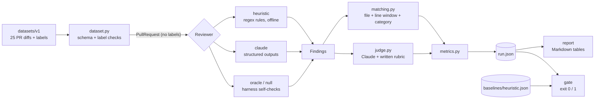

# reviewbench

[](https://github.com/kylesau/reviewbench/actions/workflows/ci.yml)

An evaluation harness for AI code reviewers. It runs a reviewer over a set of small pull
requests with hand-seeded bugs, scores its comments against labelled ground truth, reports
precision, recall, false positives on clean PRs, latency and cost, and fails CI when a change
makes the reviewer worse.

## The problem

AI code review tools are usually judged by reading a few of their comments and forming an
impression. That doesn't tell you whether a prompt change, a model upgrade or a new effort
setting made the reviewer better or worse, and a reviewer that comments on everything looks
thorough right up until engineers start ignoring it.

reviewbench treats a code reviewer like any other model under test:

- **A labelled dataset**: 25 PRs as unified diffs (Python, TypeScript, C#). 19 contain realistic
  seeded bugs (21 labelled issues) and 6 are clean, so false positives get measured too.
- **Two scorers**: a strict, deterministic matcher (file + line window + category), plus an
  optional **LLM-as-judge** that applies a [written rubric](rubrics/match_rubric.md) to decide
  whether a comment describes the same defect. The report shows how often the two agree.
- **The numbers that matter for a reviewer**: precision, recall and F1 (overall and per
  category), how many clean PRs got flagged, latency, tokens and estimated dollar cost.
- **A CI gate** that exits non-zero when recall or precision drops past a threshold against a
  committed baseline.

## Quickstart

Everything below works offline, without an API key.

```powershell
# Windows PowerShell
py -3.13 -m venv .venv
.venv\Scripts\Activate.ps1
python -m pip install -e ".[dev]"
```

```bash
# macOS / Linux
python3 -m venv .venv && source .venv/bin/activate
python -m pip install -e ".[dev]"
```

```bash
pytest                                                    # offline test suite
reviewbench run --reviewer heuristic --out runs/heuristic.json
reviewbench report runs/heuristic.json                    # Markdown to stdout
reviewbench gate --baseline baselines/heuristic.json --candidate runs/heuristic.json \
  --max-recall-drop 0.05 --max-precision-drop 0.05        # exit 1 on regression
```

`report` takes one run, or two to compare side by side with a change column. Run files are
plain JSON that hold the raw findings, the match decisions, the configuration and the
metrics, so you can report on or gate against them later without re-running anything.

### Running the Claude reviewer

```powershell
$env:ANTHROPIC_API_KEY = "sk-ant-..."     # bash: export ANTHROPIC_API_KEY=...
reviewbench run --reviewer claude --out runs/claude.json
reviewbench run --reviewer claude --judge claude --out runs/claude-judged.json
reviewbench report baselines/heuristic.json runs/claude-judged.json
```

Useful flags: `--model` (default `claude-opus-5-5`, or set `REVIEWBENCH_MODEL`), `--effort
low|medium|high|xhigh|max` (default `medium`, always sent explicitly), `--judge-model`,
`--case <id>` (repeatable, for a cheap smoke test), `--workers` (parallel cases),
`--no-fallback`. Without a key, the command stops and explains how to set one.

## Architecture



| Module | Responsibility |
|---|---|
| `models.py` | Pydantic models for cases, findings, results. `PullRequest` (what a reviewer sees) has no label fields. |
| `diff.py` | Unified-diff parser that maps every line to its new-file line number; renders diffs with those numbers for the model. |
| `dataset.py` | Loads cases, validates the schema, checks every label against its diff, computes the dataset fingerprint. |
| `reviewers/` | `heuristic`, `claude`, and the `oracle` / `null` sanity reviewers behind one small interface. |
| `llm.py` | The one place the Claude API is called: request shape, stop reasons, fallback, usage, typed errors. |
| `matching.py` | Deterministic one-to-one matcher. |
| `judge.py` | LLM-as-judge with the rubric in `rubrics/match_rubric.md`. |
| `metrics.py` | Precision/recall/F1, per category, clean-PR FP rate, latency percentiles, cost, judge agreement. |
| `report.py`, `gate.py`, `cli.py` | Markdown report, regression gate, command line. |

## The dataset

Each case is two files in `datasets/v1/cases/`: `<id>.diff` (the PR) and `<id>.json`
(title, description, ground truth). A ground-truth entry looks like this:

```json
{
  "file": "billing/digest.py",
  "line_start": 11,
  "line_end": 11,
  "category": "null_handling",
  "severity": "high",
  "description": "`billing_contact` is added in this PR as nullable and every existing customer starts with NULL, so `billing_contact.email` raises AttributeError ..."
}
```

Line numbers refer to the new version of the file. The loader rejects a case unless every
label points at a file in its diff and its range touches at least one line the PR adds, so a
typo in a line number fails the tests instead of quietly turning a correct finding into a
false positive.

| Category | Python | TypeScript | C# |
|---|---|---|---|
| off_by_one | `py-orders-pagination` | `ts-daily-revenue-series` | - |
| null_handling | `py-overdue-invoice-digest` | - | `cs-shipping-label-create` |
| sql_injection | `py-admin-user-search` | - | `cs-user-lookup-by-email` |
| missing_authorization | - | `ts-project-delete-route` | `cs-invoice-pdf-download` |
| resource_leak | `py-transactions-csv-export` | `ts-viewport-width-hook` | `cs-user-lookup-by-email` |
| race_condition | `py-inventory-reserve` | `ts-access-token-refresh` | - |
| swallowed_exception | `py-payment-webhook` | `ts-notification-settings-save` | - |
| error_handling | - | `ts-fetch-invoices` | `cs-order-receipt-handler` |
| n_plus_one_query | `py-overdue-invoice-digest` | - | `cs-team-summaries` |
| insecure_deserialization | `py-ui-prefs-cookie` | - | `cs-workflow-import` |
| *(clean)* | `py-clean-env-config`, `py-clean-retry-helper` | `ts-clean-debounce`, `ts-clean-signup-validation` | `cs-clean-checksum-service`, `cs-clean-price-batching` |

The bugs are the kind a reviewer catches in a real PR, usually with a plausible reason in
the PR description: a webhook that swallows errors "because the provider retries on non-2xx",
a `transaction.atomic` check-then-act that still oversells, a token refresh that breaks under
concurrent requests when refresh tokens are single-use, a new nullable foreign key
dereferenced in a nightly job. Two cases have two issues each. One clean case
(`cs-clean-price-batching`) deliberately looks like an N+1 query but is correct batching.

## How scoring works

**Deterministic matcher** ([matching.py](src/reviewbench/matching.py)). A finding matches a
labelled issue when it is in the same file, its line range is within 3 lines of the issue's
range (`--line-tolerance`), and the categories are the same or an explicitly listed
near-synonym pair (`swallowed_exception` and `error_handling`; `off_by_one` and
`logic_error`). Matching is one-to-one: the closest finding wins an issue, and a second
finding about the same issue counts as a false positive, because duplicate comments cost
reviewer attention too.

**Counting rules** ([metrics.py](src/reviewbench/metrics.py)):

- TP = matched finding, FP = unmatched finding, FN = unmatched issue.
- Only cases whose status is `ok` are scored. API errors, refusals and responses cut off at
  `max_tokens` are recorded with their own status and shown in the report. They are never
  scored as "the reviewer found nothing", because that would make a crashing reviewer look
  precise. Their token cost is still counted.
- A ratio with a zero denominator is reported as `n/a`, not 0 or 1.
- Precision and recall come with 95% Wilson score intervals. With 21 issues they are wide,
  and the report shows that rather than hiding it.

**LLM-as-judge** ([judge.py](src/reviewbench/judge.py), [rubric](rubrics/match_rubric.md)).
The matcher checks *where* and *what kind*. The judge checks *whether it's the same defect*:
same root cause, same place, specific enough to act on. Category labels and severity don't
matter to it, and vague hedges ("consider adding error handling") don't match. It sees the
diff, the issues and the findings, but not the matcher's decision or which reviewer wrote
the findings. It is only called when a case has both findings and issues; otherwise the
answer is fixed (all misses, or all false positives). The report gives judge-scored
precision and recall next to the matcher's, the agreement rate, Cohen's kappa, and a table
of disagreements, which are the cases worth reading by hand.

**Harness self-checks.** `--reviewer oracle` feeds the ground truth back as findings and must
score 100%. `--reviewer null` returns nothing and must score 0 recall with no clean-PR flags.
Both run in the test suite, so a wiring bug in the loader, matcher or metrics fails CI.

## Results

### Heuristic baseline

Produced by `reviewbench run --reviewer heuristic`; these are the numbers in the committed
[`baselines/heuristic.json`](baselines/heuristic.json). The heuristic is deterministic, so
you get exactly these numbers when you run it.

| Metric | Heuristic |
|---|---|
| Precision (95% CI) | 92.3% (67-99%) |
| Recall (95% CI) | 57.1% (37-76%) |
| F1 | 70.6% |
| TP / FP / FN | 12 / 1 / 9 |
| Clean PRs with any finding | 1 of 6 |
| Latency per case | under 1 ms |
| Cost | $0 |

| Category | Found |
|---|---|
| insecure_deserialization, resource_leak, sql_injection, swallowed_exception | 9 of 9 |
| error_handling, n_plus_one_query, off_by_one | 1 of 2 each |
| missing_authorization, null_handling, race_condition | 0 of 6 |

The pattern is the reason to have a baseline. Regex rules catch what has a syntactic
signature (`pickle.loads`, an f-string in SQL, `async void`, an empty `catch`). They miss
everything that needs intent or context: a delete route that checks login but not
ownership, a check-then-act race, an N+1 hidden behind ORM attribute access. The one false
positive is the deliberately tricky clean case, correct chunked batching inside a loop.

Read these numbers with care. The rules and the dataset were written by the same author, so
the heuristic's score is an optimistic estimate of what regex-level tooling would do on
this set.

### Sanity checks

| Reviewer | Precision | Recall | Clean PRs flagged |
|---|---|---|---|
| `oracle` (ground truth as findings) | 100% | 100% | 0 of 6 |
| `null` (no findings) | n/a | 0% | 0 of 6 |

### Claude: run it yourself

There are no Claude numbers in this README. The repository was built on a machine without
an Anthropic API key, and it publishes only numbers that were actually measured. To produce
them:

```bash
export ANTHROPIC_API_KEY=...
reviewbench run --reviewer claude --judge claude --out runs/claude.json
reviewbench report baselines/heuristic.json runs/claude.json
```

The report includes token usage and an estimated cost (list prices in
[pricing.py](src/reviewbench/pricing.py), retrieved 2026-10-13). To check your setup cheaply
first, add `--case py-admin-user-search`.

## The CI gate

[`.github/workflows/ci.yml`](.github/workflows/ci.yml) runs on every push and pull request:

1. `ruff check`, `ruff format --check`, `pytest` (all offline; the Anthropic client is mocked).
2. `reviewbench run --reviewer heuristic`, then a report into the job summary.
3. `reviewbench gate --baseline baselines/heuristic.json --candidate runs/heuristic-ci.json
   --max-recall-drop 0.05 --max-precision-drop 0.05`.

The gate refuses to compare runs made on different datasets (fingerprint mismatch) or with
different line tolerances, and by default fails if any candidate case was unscored. Changing
a label or a heuristic rule therefore means regenerating the baseline in the same PR, where
the diff of `baselines/heuristic.json` shows exactly what moved. A test
(`test_committed_baseline_is_reproducible`) enforces this.

A second, optional job runs the Claude reviewer with the judge and gates it against the
heuristic floor. It runs only on `main` or by manual dispatch, and only when an
`ANTHROPIC_API_KEY` repository secret exists. Otherwise it logs a notice and skips.

## How the Claude API is used

All calls go through [`llm.py`](src/reviewbench/llm.py) using the official `anthropic` Python
SDK:

- **Model** `claude-opus-5-5` by default, configurable. **Adaptive thinking**
  (`thinking={"type": "adaptive"}`); this model always thinks, and `budget_tokens` is not
  used. **Effort** is set explicitly on every call (`output_config.effort`, default `medium`).
- **Structured outputs** (`output_config.format` with a JSON schema) for both reviewer
  findings and judge verdicts. No forced `tool_choice` and no assistant prefill. The parsed
  JSON is validated again with pydantic.
- **`stop_reason` is checked before content is read.** `refusal` and `max_tokens` become
  their own case statuses. Content is read by block type, since thinking blocks come first.
- **Server-side refusal fallback** is on by default: `betas=["server-side-fallback-2026-07-01"]`
  with `fallbacks="default"`. If a safety classifier declines a request (security-flavoured
  code such as an injection example can occasionally trigger one), the API re-runs it on
  Anthropic's recommended fallback model within the same call. For an eval this is a
  confound, because that case was answered by a different model. So reviewbench records
  `fallback_used` and `served_model` per case, prices each attempt at the model that ran it
  (from `usage.iterations`), and reports how many cases a fallback served. Use
  `--no-fallback` to measure one model only, or for models and platforms without
  server-side fallback.
- **Typed errors, most specific first.** Authentication, permission, not-found and
  bad-request errors abort the run, since every case would fail the same way. Rate limits
  (after the SDK's own retries), 5xx, timeouts and connection errors are recorded on the
  case, and the run continues.
- **Credentials** come from the environment the normal SDK way (`ANTHROPIC_API_KEY`). The
  stable system prompt is marked cacheable.

## Limitations

- **Small dataset.** 21 labelled issues means one issue moves recall by about 4.8 points,
  so the default 0.05 gate threshold effectively allows one additional miss. The confidence
  intervals in the report make this visible. More cases is the first item on the roadmap.
- **Single run, no repetitions.** LLM output varies between runs. A real comparison between
  two prompts or models needs several repetitions and paired differences. Today's numbers
  are point estimates.
- **Labels are incomplete by nature.** If a reviewer finds a real problem that isn't
  labelled, it counts as a false positive. Read the FPs: the fix is to promote real ones into
  the labels and version the dataset (v1 to v2), not to tune the reviewer to the labels.
- **Synthetic, small diffs.** Cases are 12-78 line diffs without repository context. Real
  review involves large diffs, cross-file context and team conventions that this set does
  not capture.
- **The judge is unvalidated.** Here it is only tested against mocked responses. Before
  trusting judge-scored numbers, calibrate it on human-labelled verdicts and check that it
  rejects known non-matches. Using the same model as reviewer and judge risks
  self-preference; the CLI warns about it and `--judge-model` lets you pick another.
- **Latency includes SDK retries.** It is measured around the SDK call, which retries 429s
  and 5xx responses internally.
- **Heuristic optimism.** See the note under Results.

## Roadmap

- `--reps N` with paired-difference confidence intervals for prompt or model A/B comparisons.
- Grow the dataset (multi-file diffs, larger PRs, more languages) and version it.
- Calibrate the judge against a human-labelled verdict set and report judge accuracy.
- Effort sweep (`low` / `medium` / `high`): quality versus cost and latency in one report.
- Severity-weighted recall, so missing a critical issue costs more than missing a low one.
- Per-category gate thresholds, so one category can't collapse while the totals hold.

## How this was built

Built with AI-assisted development, using Claude Code as a pair programmer. The reasoning
behind each design decision is written up in [docs/WALKTHROUGH.md](docs/WALKTHROUGH.md).

## License

[MIT](LICENSE)
